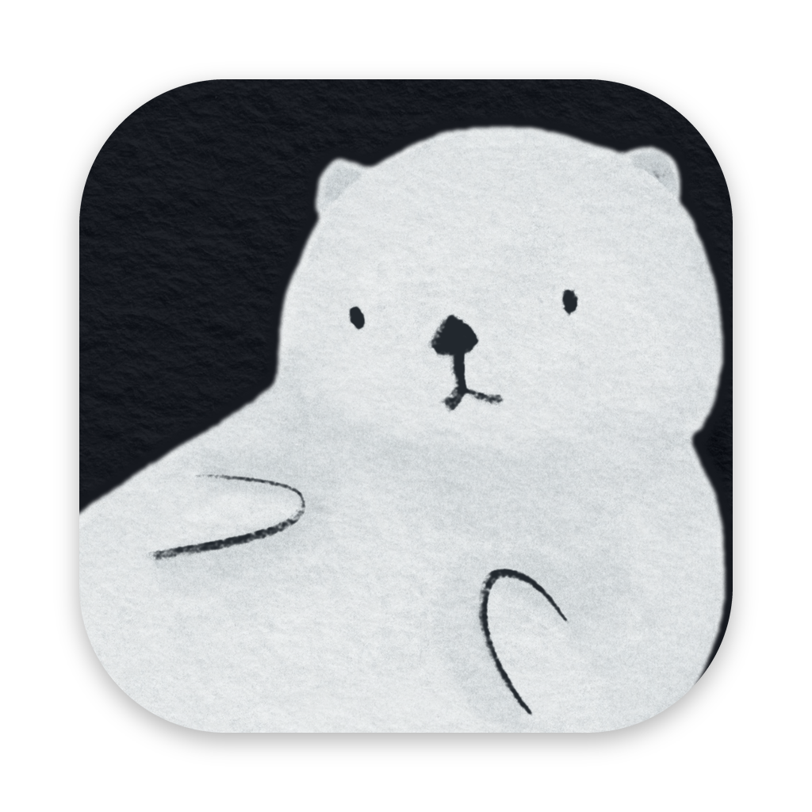

<p align="center">
  
</p>

<h1 align="center">Otter Pocket</h1>

<p align="center"><b>A reference board for artists that remembers where everything came from.</b><br>
Clip it from anywhere. See it on one canvas. Go back whenever you need more.</p>

<p align="center"><a href="https://milesyan-art.github.io/otter-pocket/"><b>Download Otter Pocket for Mac</b></a> · free</p>

---

Artists don't only learn from pictures anymore. A reference can be an illustrator whose style you love, a shop page full of brush examples, or the moment in a video that shows how an animal moves. Every tool keeps part of that. Otter Pocket clips all of it onto a canvas, and every clip keeps its way back to where you found it.

## How it works

1. **Clip.** In Chrome, right-click any image or video and choose **Save to Otter Pocket**. You can also save the frame of a playing video, a region you drag out, or the whole page, such as an artist's profile. Add one line on why it matters, if you like.
2. **Arrange.** Each project gets its own canvas: see everything at a glance and move it around freely. Nothing is on it unless you chose it. The few things you want to keep for good go in the **Vault**.
3. **Go back.** Double-click any clip to open its source: the page, the artist's site, or the video at that exact second.

## Why use it

- **It's a board, not a workspace.** No pages, databases or feed to keep up with.
- **A clip can be more than a picture.** A video frame, a page or an artist, and each one keeps its way back.
- **Full quality.** Each image is saved at the largest size the site offers. A saved Pinterest pin also keeps the link to where the image first came from.
- **Light.** A small Mac app and a Chrome extension.
- **Yours.** No account, no cloud, no tracking. Your library is one ordinary folder in Documents. Copy it to a new computer and open it there.

## Saving from Chrome

| To save | Do this |
| --- | --- |
| An image or a video | Right-click it → **Save to Otter Pocket** |
| The frame of a playing video | <kbd>⌥</kbd><kbd>⇧</kbd><kbd>S</kbd> (Alt+Shift+S) |
| A region of the page | <kbd>⌥</kbd><kbd>⇧</kbd><kbd>A</kbd>, then drag |
| The page itself | The Otter Pocket button in Chrome's toolbar → **Save this page** |

The only question when you save is where it goes: the Vault or one of your projects. If the app is closed, saves wait in Chrome and arrive the next time it opens.

Otter Pocket is for private reference. It saves only what a site shows you, never a copy-protected video's frames, and every clip keeps a link back to its source, so you can always find the artist again. Ask the artist before you repost or reuse their work.

## Your library is a folder

Everything lives in one folder, `Documents/Otter Pocket` by default. The first launch explains this and creates the folder, or opens the library already there. Nothing is stored in a cloud or an account; the only thing this computer remembers outside the folder is where the folder is.

- **New computer:** copy the folder over (or keep it in iCloud Drive or Dropbox), install Otter Pocket, and choose **Open an existing library**. If the folder is in `Documents/Otter Pocket`, **Set up my library** finds it on its own.
- **Moved or renamed it:** Otter Pocket says it can't find the library and asks where it went. It never quietly creates an empty one in its place.
- **Two computers sharing one folder:** the second computer warns before opening a library that's already open somewhere else.
- **Older app, newer library:** an older Otter Pocket refuses to open a library made by a newer one and leaves it untouched. A newer Otter Pocket upgrades older libraries.
- The sidebar footer shows the open library, with **Show in Finder**, **Open another library…** and **New library…**.

## Why an otter

Sea otters have a pocket: a fold of loose skin under each front leg. They keep food in it, and a favourite stone they use to crack open shells. Otter Pocket is that pocket for your references.

## Status

Get it from the [download page](https://milesyan-art.github.io/otter-pocket/), which also walks you through installing it. It runs on Macs with Apple silicon, with the extension in Chrome. Every version is also listed under [Releases](https://github.com/milesyan-art/otter-pocket/releases).

---

# For developers

npm workspaces: `apps/desktop` (Tauri 2 + React + PixiJS), `apps/extension` (WXT, Chrome MV3) and `packages/shared` (the contract between them).

## How it fits together

```
Chrome extension (apps/extension)            Desktop app (apps/desktop, Tauri)
  right-click → Save to Otter Pocket ─POST─▶   127.0.0.1:47600  (capture server)
  ⌥⇧S video frame · ⌥⇧A region                 │
  toolbar: save this page                       ▼
  (queues captures while the app is closed)    ~/Documents/Otter Pocket/   (the library: one self-contained folder)
                                                  library.db   SQLite: collections, items, placements
                                                  assets/      images, stored once by content hash
                                                  library.lock only while open (warns a second computer)
                                                React UI: project tree · Vault grid · PixiJS canvas · inspector
```

`packages/shared` holds the capture payload types and `buildReturnUrl()`, which turns a saved source into the link that takes you back. The library keeps only its location outside the folder, in the app's `settings.json`; `library.lock` is refreshed every minute while open, and each library records its schema version.

## Run it

Prerequisites: Node 22+, Rust (`rustup`), Xcode Command Line Tools.

```bash
npm install
```

```bash
npm run desktop
```

Build the extension, then load it in Chrome: open `chrome://extensions`, turn on **Developer mode**, click **Load unpacked**, and choose `apps/extension/dist/chrome-mv3`.

```bash
npm run extension:build
```

`npm run extension` starts WXT's dev mode instead, with its own Chrome profile and live reload.

To rehearse first-run setup without touching your real settings or Documents, give the app a sandbox. Its settings and `Documents` live inside that folder:

```bash
OTTERPOCKET_SANDBOX=/tmp/otterpocket-sandbox npm run desktop
```

To skip setup and open (or create) a particular library without remembering it:

```bash
OTTERPOCKET_LIBRARY=/tmp/otterpocket-test npm run desktop
```

## Checks

```bash
npm test
```

```bash
npm run typecheck
```

```bash
cd apps/desktop/src-tauri && cargo test
```

## Icons

Every app and extension icon is made from the otter drawing in `design/icon/`. To change the background colour or the framing, edit the top of `make_icons.py` and run:

```bash
python3 design/icon/make_icons.py
```

## What's built

- Capture from Chrome: any image (finds the picture under the pointer even when a transparent layer covers it, and takes the largest `srcset` candidate the page lists; no URL rewriting), video frames at native resolution (screenshot fallback for cross-origin video; copy-protected video is refused, as Chrome's own Save video frame does), drag-to-select regions, and whole pages saved as cards with their share image (marked **Artist** when the page is clearly a profile, otherwise **Page**).
- Save panel: the only choice is where it goes. Click the Vault or a project to save there; the last one used comes first, and Enter saves to it. An optional line says *why it matters*. The type is detected and the title comes from the page (edit it later in the app).
- Reverse links: YouTube `?t=`, Vimeo `#t=`, other video sites via a `#otterpocket-t=` fragment the extension seeks on load, and text fragments (`#:~:text=`) for images in articles. Pinterest pins also keep the pin's original source.
- Desktop: Vault card grid, project tree with folders, PixiJS canvas (pan, pinch/⌘-scroll zoom, drag, resize handle, fit, black-and-white value check) where each board reopens at the zoom and position you left it, an Arrange tool (tidy up, grid, columns) with undo, always-on-top, an inspector on the right with notes and "On boards", the library folder at the foot of the sidebar, and a status line that shows whether the Chrome extension is checking in.
- Offline: the extension queues captures (badge shows the count) and sends them when the app is open.

## Security

The capture server binds to `127.0.0.1` only, rejects requests whose `Host` isn't its own (DNS rebinding), and rejects any request with a web-page `Origin`, so websites can't read or write your library. Requests from the extension (`chrome-extension://…`) and local tools without an Origin are accepted. Pairing the app to one specific extension ID is a planned hardening step.

## Next

- Canvas tools: crop, flip, rotate, multi-select, color picker, drag images out to other apps, image thumbnails for very large boards.
- Later: optional page archive (MHTML) against link rot, search by site/color/similarity, a global capture hotkey outside Chrome, Firefox/Safari, and sharing a board as a web link.
